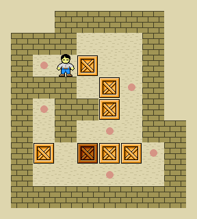

# COMP2045 Programming Assignment - Sokoban 

## 2026-27 Semester 1

* Designed by: [Dr. Kevin Wang](mailto:kevinw@comp.hkbu.edu.hk)
* Assignment Website: [GitHub](https://github.com/khwang0/COMP2045-2627PA1)
* Due: 
  * Programming Due: 23:59pm 28/11/2026 (Saturday midnight)
* Download the demo program: [here](demo.jar)
* Download everything from the assignment: [here](https://github.com/khwang0/COMP2045-2627PA1/archive/refs/heads/master.zip)

> To run the demo program, type the following in your terminal:
> 
> ```sh
> java -jar demo.jar
> ```



<sub><sup>

image ref: [Carloseow at English Wikipedia](https://en.wikipedia.org/wiki/Sokoban#/media/File:Sokoban_ani.gif) 

</sup></sub>

# Learning outcome

Students are expected to have some practice on arrays/2D arrays/parameter passing/method construction and usage in this assignment. We expect most students would spend six hours or more to finish the assignment without any assistance. Make sure you start earlier as possible and ask us on Discord if you have any difficulty! Note: we want to familiarize arrays and 2D arrays, so you are not supposed (and not allowed) to use advanced data structures like ArrayList, Set, etc...


# Introduction

You are going to complete the Sokoban program! Open the Java files: [Sokoban.java](Sokoban.java), [Map.java](Map.java), and [Board.java](Board.java) and complete the TODO methods stated in the skeleton code. Some of these methods are very straightforward while some of them ain't that easy. Make sure you can follow the instructions given at the top of each method.

A [sample program](demo.jar) is given to you. When there is something you are not sure, you can take a look at the sample program to decide what to do. 

Some methods are labeled as completed. Please don't make any change on those methods. You are not supposed to modify them. **You can add your own private method if you want to**. However, you cannot add any class variable (field) or additional class. You are also not allowed to change the method `main`. If you do so, you will lose marks.

## Explanation of the game Sokoban


You can skip this section if you have some experience in playing the game Sokoban. It is a role play game where a player tries to push boxes to the target locations. The player can only push the box but not pull it. The player can only push one box at a time. The player can only move to an empty space or a target location. The player cannot move to a wall or a box. The player wins the game when all target locations have a box on it. 

## Explanation about the assignment

You are given the skeleton code. Complete all methods in the assignment with respect to the instructions stated in the Java file.


## `TestCase` class

You don't need to do anything with this java file. The purpose of this file is to conduct some *unit test* for your code. Run the TestCase in IntelliJ to see if your code is working properly. We will grade your assignment based on the correctness of your code. If your code cannot pass the test, you will lose marks.

---


# Submission 
For submission upload the files `Map.java` and `Board.java` to Moodle.  


 ## Plagiarism

 Plagiarism is a serious offense and can be easily detected. Please don't share your code to your classmate even if they are threatening you with your friendship. If they don't have the ability to work on something that can compile, they would not be able to change your code to a state that we can't detect the act of plagiarism. For the first commit of plagiarism, regardless you shared your code or copied code from others, you will receive 0 with an addition of 5-mark penalty. If you commit plagiarism twice, your case will be presented in the exam board and you will receive a F directly.


## Marking Scheme 
This assignment is worth 14% of the course mark (7% for COMP2026).  There are three elements in the marking scheme: 

* 15% - the program can be compiled without any error
* 85% - a working program that functions as specified 
* -50% - if you define any class variable (field), addition class, or change the method `main`.
* -30% - if you use any advanced data structure such as `java.util.List`, `java.util.ArrayList`, `java.util.Arrays`, `java.util.Set`, `java.util.Map` etc to replace your primitive array.
* -10% - if your programme cannot be compiled using Java 11 but can be compiled using a higher version of Java.

Please note that submitting a program that cannot be compiled would result in a very low mark. 

For the correctness of your program, we will test your program with a set of test cases.  The test cases will be similar to the sample program.  All test cases will be released after the submission deadline.  
 

## Interview 
Should the teaching team see fit, students may be requested to attend an interview to explain about their program.  Students failing to attend such interview or to demonstrate a good understanding of their own program may result in mark deduction. 

# Known Issues

> It is known that if a player is on a goal and saves the game. The goal may disappear when the game is loaded. This is a known issue and we will not penalize you for this. You can try to fix it if you want to, but it is not required.
> 
> This issue appears in the sample program as well.

